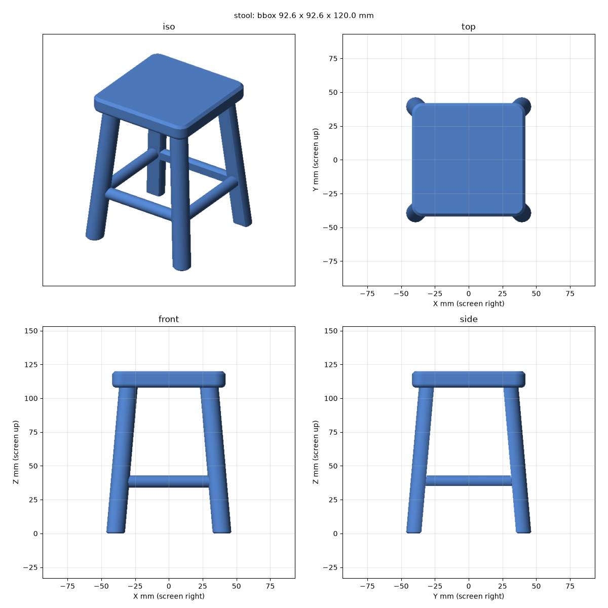
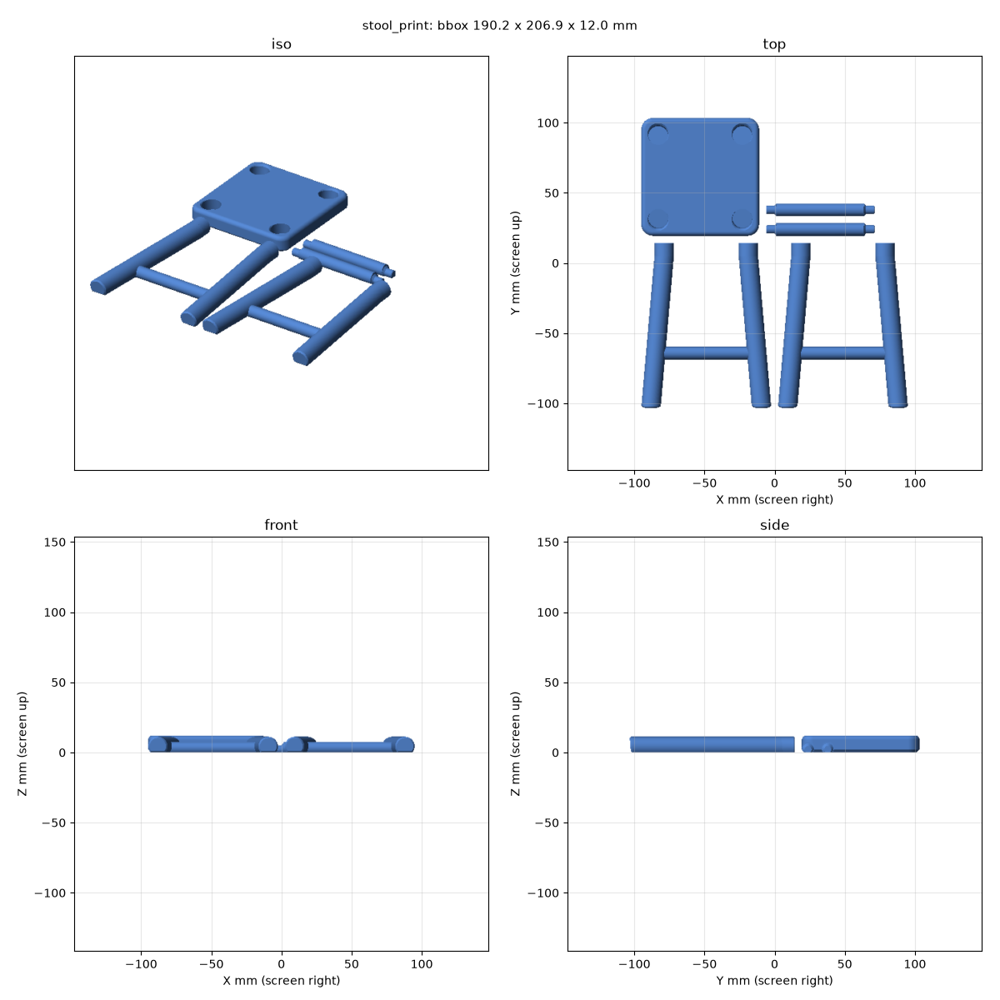

# example-stool

A 120 mm scale-model stool, designed by an AI coding agent as parametric CAD in [build123d](https://build123d.readthedocs.io/) and split into five glued parts for FDM 3D printing (0.4 mm nozzle, PLA/PETG, no supports).

This project is derived from the template [agentic-3d/example-base](https://github.com/agentic-3d/example-base). `CLAUDE.md` and `RULES.md` are owned by the template and synced from it. Everything else here is specific to the stool.



## Design

The stool is sized from reference photos as ratios of `HEIGHT`, so one number in `models/stool_params.py` rescales it. Following [RULES.md](RULES.md), it is not printed as one body: a flat slab, long slender legs and horizontal stretchers need different print orientations.

- Two adjacent splayed legs and the stretcher between them lie in one plane. That makes a **side frame**, which prints lying flat with layers along every member.
- Every round member has a **bed flat**. On the frames it is the inward face, on the stretchers the underside, so it is hidden.
- **Leg to seat**: the leg continues as the peg (13.8 mm, 9 mm deep) into a socket that leans 5 degrees. The socket floor is the stop, the flat lets glue and air out. Both pegs of a frame are parallel, which also keys its orientation.
- **Stretcher to leg**: a shouldered 6 mm peg, 7 mm deep. The shoulder lands on the leg's flat, and the socket is 0.5 mm deeper than the peg.
- Fit clearance is 0.2 mm per side everywhere.

## Models

| Model | Description | Print | Expected bbox (mm) |
|---|---|---|---|
| `stool_seat` | Seat, top face on the bed, four leaning sockets | 1x | 84 x 84 x 12 |
| `stool_frame` | Side frame: two legs and a rail, lying on the inward flat, two stretcher sockets | 2x | 92.6 x 117.9 x 11.2 |
| `stool_stretcher` | Cross stretcher with a peg at each end, lying on its flat | 2x | 77.3 x 9 x 7.7 |
| `stool_leg` | One leg with its peg, component of `stool_frame` | - | 23.2 x 117.9 x 11.2 |
| `stool` | Assembled stool, 5 separate bodies with a 0.2 mm gap at every joint | - | 92.6 x 92.6 x 120 |
| `stool_print` | Print plate with all 5 parts in print orientation | 1 plate | 190.2 x 206.9 x 12 |

`models/stool_params.py` holds every parameter and the rule checks (joint depth, socket wall and floor, bed size) as asserts. `models/stool_joint.py` is the shared socket cutter. Neither is a model.

## Print and assemble



1. Slice `out/stool_print.stl` as it is: one plate, no supports, no brim needed.
2. Dry-fit every joint. If a peg is tight or loose, change `CLEARANCE` in `models/common.py` and run `make`.
3. Glue both stretchers into one frame, flat facing the floor, with CA or epoxy. Add the second frame.
4. Before that glue sets, push all four leg pegs into the seat together. The frames close in by about 0.8 mm per side while they seat, and the stretcher pegs slide deeper by the same amount.

## Setup and usage

Requires Python >= 3.12 and [uv](https://docs.astral.sh/uv/). Run everything from the project root.

```bash
uv sync
```

```bash
make                # build, check and render every model
make stool_frame    # one model
make clean          # remove out/ (rebuild with make before committing)
make sync-base      # refresh CLAUDE.md and RULES.md from the base template
open out/stool.stl  # preview with macOS Quick Look
```

`make <name>` writes `out/<name>.stl`, checks that the mesh is watertight and has the expected body count, and renders `out/<name>.png`. `out/` is committed, so commit the regenerated files together with a model change.

## Layout

```
models/
  common.py           shared print constants (CLEARANCE, MIN_WALL, BED_MAX, GLUE_GAP, ...)
  stool_params.py     all stool parameters, derived values and rule checks
  stool_joint.py      socket cutter
  stool_seat.py, stool_leg.py, stool_frame.py, stool_stretcher.py    parts, in print orientation
  stool.py            assembled stool
  stool_print.py      print plate
tools/                build, check and render scripts
docs/                 build123d API notes and print recipes
out/                  generated STL/PNG output (committed)
Makefile              model list and targets
RULES.md              design planning rules (base-owned, synced)
CLAUDE.md             guidance for Claude Code (base-owned, synced)
```
